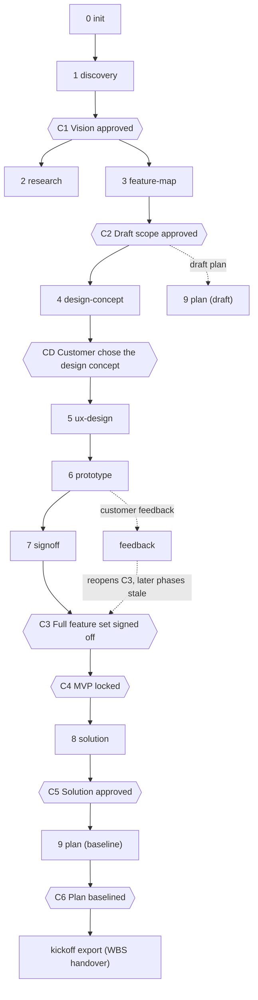

# kickoff

A Claude Code plugin that takes a software project from the first customer meeting to a baselined plan with its WBS and estimate, through a fixed sequence of phases and approval gates. It holds **process and design philosophy, no stack and no design values**, so it runs for any kind of project: a web tool, a game, a mobile or desktop app, a service. Twelve skills carry the judgement work: discovery, research, feature map, design concept (the customer chooses structure and feel), UX design, a full-product prototype built with whatever tools suit the product, customer sign-off and feedback, solution design, and plan and estimate. A tested Python CLI does everything that must be exactly right: validation, the role-based schedule, the estimate workbook, generated documents and the WBS export. Kickoff creates no tracker issues: `kickoff export` hands the WBS to the team's tracker or to ECC. Approval gates are recorded in `.kickoff/state.yaml` with who approved, when, and the evidence. A customer-feedback loop can reopen the sign-off and marks every later output stale until it is re-run. All project data lives in plain YAML under `.kickoff/`, so every plan, estimate and export can be regenerated from it.

The core principle:

> Lock the MVP scope, but lock the **full** feature set with the customer first, using a clickable or experienceable prototype of the final product, built with whatever tools suit the product. Only then design the database, backend technology, architecture and design patterns. Features built after that rarely expand in scope or need refactoring because of late customer feedback.

The plugin enforces this with gates: `solution` refuses to start until C3 (full feature set signed off) and C4 (MVP locked) are approved.

**Structure and feel are the customer's, too.** Kickoff takes no palette, layout or rule from a catalogue or from another project. `kickoff:design-concept` writes a design brief from the product's own world and builds two or three concepts that differ in kind (flow, structure, interaction model, pace, tone, look); the customer compares them in a co-design session and gate CD locks the choice before the spec is expanded. `kickoff:ux-design` then derives the project's own `design-rules.md`, each rule with its reason and a test, and ends with a fit test: what makes this not a different kind of product? Review agents read the concepts and the spec, not only the finished prototype. The philosophy is `skills/using-kickoff/references/design-philosophy.md`.

**Decisions are visible.** Every design confirmation and every gate request is a *decision card*: what it decides and locks; two or three options, each with what the person will see, who it serves, what it costs and where a wrong choice would surface; a recommendation with its reason; what was assumed; and always "none of these" and "show me first". Nobody is asked to choose blind.

## Phases and gates



| # | Skill | May start when | Outputs | Gate to leave |
| --- | --- | --- | --- | --- |
| 0 | `kickoff:init` | no `.kickoff/` yet | `project.yaml`, docs skeleton, `AGENTS.md` | none |
| 1 | `kickoff:discovery` | init done | vision and scope, stakeholders, open questions | C1 Vision approved |
| 2 | `kickoff:research` | discovery done, C1 | validation plan, ADRs *Proposed*, assumptions | none (runs alongside 3) |
| 3 | `kickoff:feature-map` | discovery done, C1 | `features.yaml`, feature map, NFRs | C2 Draft scope approved |
| 4 | `kickoff:design-concept` | feature-map done, C2 | design brief, concepts, co-design record, the chosen concept and its ADR | CD Customer chose the design concept |
| 5 | `kickoff:ux-design` | design-concept done, CD | `ux-spec.md` with the screen inventory, `design-rules.md`, the fit test | none |
| 6 | `kickoff:prototype` | ux-design done | the prototype (tooling recorded as an ADR), `prototype-coverage.md`, the build plan | none |
| 7 | `kickoff:signoff` | prototype done | workshop pack, sign-off record | C3 Features signed off, C4 MVP locked |
| ↺ | `kickoff:feedback` | prototype done | classified feedback, updates along the chain | reopens C3 (and CD for a concept remark) |
| 8 | `kickoff:solution` | signoff done, C3 and C4 | architecture, data model, accepted ADRs | C5 Solution approved |
| 9 | `kickoff:plan` | draft: feature-map done, C2; baseline: solution done, C5 | plan, schedule, estimate workbook, WBS, risks | C6 Plan baselined |

Gate rules:

- A gate is approved only with `--by` (the approving role) and `--evidence` (a link to the record or commit). C4 needs C3; C6 needs C5. CD is approved by the customer.
- Reopening a gate (`kickoff gate reopen C3 --reason "..."`) marks every later phase that was done as stale. A stale phase blocks the phases that depend on it until it is re-run; re-running it removes the gates that follow it, so they are approved again.
- `kickoff:feedback` is not a phase; it is a loop that classifies customer feedback, applies it along the chain `features.yaml`, `ux-spec.md`, prototype, draft `plan.yaml`, schedule, and reopens C3.
- Every phase ends with real verification commands, then `kickoff phase done <phase>` and a Conventional Commit. Rulings (judgement calls) are listed to the lead at every task-group end and every gate.

`kickoff:using-kickoff` is the router: it checks the tools, reads `kickoff status`, enforces the gates and hands over to the skill that comes next.

## Install

In Claude Code:

```
/plugin marketplace add ivai-dev/kickoff-plugin
/plugin install kickoff@kickoff
```

Then install the CLI from the installed plugin copy. The plugin lives under `~/.claude/plugins/cache/kickoff/kickoff/<version>/`:

```
uv tool install --force ~/.claude/plugins/cache/kickoff/kickoff/<version>/cli
```

Repeat the CLI install after every plugin update. `kickoff:using-kickoff` compares `kickoff --version` with the version in `.claude-plugin/plugin.json` and asks you to reinstall when they differ. The document templates and the LibreOffice Dockerfile ship inside the package, so the normal (non-editable) install works outside this checkout.

## Requirements

- Python 3.11 or newer and [uv](https://docs.astral.sh/uv/)
- Optional: Docker, for `kickoff workbook --verify` (LibreOffice recalculation)
- The ECC plugin (`ecc@ecc` 2.2.3 or later): required; `kickoff ecc doctor` checks it
- Nothing else. The prototype's tools are the project's choice. For web UI work, Anthropic `frontend-design`, `impeccable` and `ui-ux-pro-max` are optional aids; they never choose the look.

## Quickstart

1. Open an empty repository in Claude Code.
2. Run `/kickoff`. With no `.kickoff/` folder it routes to `kickoff:init`, which interviews you and runs `kickoff init --name <name>`.
3. Follow the next step `/kickoff` names after each phase. It reads `kickoff status`, so it always knows which phase may start and which gate is waiting for approval.
4. After C6, `kickoff export` writes `wbs.csv`, `wbs.json` and `wbs-items.md` for the team's tracker importer or an ECC session.

## CLI reference

Run `kickoff --help` or `kickoff <command> --help` for every option. `--root DIR` selects the project (default: the nearest folder with `.kickoff/`).

| Command | What it does |
| --- | --- |
| `kickoff init --name NAME [--nested]` | Create `.kickoff/` from a valid template and the docs folders; refuses if `.kickoff/` exists, or if a parent folder has one unless `--nested` (a separate product inside another project's repository). |
| `kickoff status [--json]` | Show phases, gates, stale items and the suggested next step. |
| `kickoff can PHASE [--baseline]` | Exit 0 when the phase may start, 1 with the blocking phases and gates. |
| `kickoff phase start\|done PHASE` | Record phase progress; `done` clears the phase's stale marker. |
| `kickoff gate approve GATE --by ROLE --evidence LINK [--date D]` | Approve a gate; both `--by` and `--evidence` are required. |
| `kickoff gate reopen GATE --reason TEXT` | Reopen a gate and mark the later phases stale. |
| `kickoff validate` | Check schemas, IDs, dependencies and cycles, and the ux-spec screen inventory (unique IDs, existing releases, every screen of an active feature listed); exit 1 on any error. |
| `kickoff schedule [--json FILE]` | Compute the role-based schedule and gate dates; warn when a hard date slips and list the scope-cut candidates. `--json` writes every package's dates to FILE. |
| `kickoff workbook [--out FILE] [--verify]` | Write the formula-only estimate workbook; `--verify` recalculates it with LibreOffice in Docker and compares it with the schedule. |
| `kickoff docs [--check]` | Generate `feature-map.md`, `wbs.md`, `risk-register.md` and the plan tables; `--check` fails if regeneration would change anything. |
| `kickoff export [--out DIR] [--format csv,json,md] [--lang LANG]` | Write the WBS (one record per package: role, effort, deps, release, features, baseline dates and the `item` fields) as CSV, JSON and Markdown under `<docs_root>/06-planning/export/`. |
| `kickoff check-docs PATHS...` | Find `{{` placeholders, forbidden phrases and `design.forbidden` patterns in written files, with file and line. |
| `kickoff prototype record --artifact LINK\|PATH [--version N]` | Record where the prototype was published (a link or a path) and its version in `state.yaml`. |
| `kickoff ecc root\|doctor\|setup\|run` | Locate and check the ECC plugin, exempt kickoff documents from GateGuard (`setup`, `--router` for the ecc-router route), run ECC scripts from the ECC folder. |
| `kickoff hook EVENT` | The plugin's Claude Code hooks: session start, pre-write guards, validate after edits. |

`state.yaml` is never hand-edited: a hook refuses it. The `design` block of `project.yaml` holds `ux_spec` (default `docs/05-design/ux-spec.md`) and `forbidden` (patterns that must never reach the product's user-facing text).

## Design, without a shipped stack

Kickoff no longer scaffolds a frontend or ships design rules. What it keeps:

- **A process** that puts structure before skin, the customer before the spec and review before the build (`design-concept`, `ux-design`, `prototype`).
- **A philosophy** with a test per principle, the brief questions that decide the form, the fit test and the shape of a project's own rules (`skills/using-kickoff/references/design-philosophy.md`).
- **Five read-only review agents** (`art-director`, `craft-auditor`, `ia-reviewer`, `viewpoint-reviewer`, `integrator`) whose criteria come from the brief and the project's `design-rules.md`, run on the concepts and the spec as well as on the prototype.
- **Templates** for the brief, the concepts, the co-design record and the project's design rules.

## Migrating from 0.5 to 0.7

Projects keep working: `kickoff status` migrates `state.yaml` in memory (`design-direction` becomes `design-concept`; `fe-foundation` and gate CF are dropped; a finished `ux-design` without a concept is marked stale and re-run after CD). A project that started its prototype keeps going and shows the skipped phases as `skipped (…)`. Rename the `fe` block of `project.yaml` to `design` (only `ux_spec` and `forbidden` remain; `kickoff validate` warns). `apps/` and `packages/` become ordinary project code: kickoff no longer owns or guards `packages/kit`. The kit and its rules stay in git history under the tag `v0.7.0`. See `CHANGELOG.md`.

## Examples

- `examples/ai-minute`: a full worked project (Vietnamese content, workbook language `vi`): features, a 205-package plan with work-item blocks and the golden schedule `expected/schedule.json` that the scheduler must reproduce. The generated documents under `examples/ai-minute/docs/` are kept in step with `kickoff docs --check`.
- `examples/mini`: a small Library Loans project (roles, a UX spec with four screens), used to check `kickoff validate` and the screen inventory.

Try them without changing anything:

```
cd cli
uv run kickoff --root ../examples/ai-minute status
uv run kickoff --root ../examples/ai-minute schedule
uv run kickoff --root ../examples/mini status
```

## Development

```
cd cli
uv run ruff check .
uv run pytest -q
```

Tests run offline except those marked `docker` (need Docker) and `ecc` (the installed ECC plugin); they skip when the tool is missing. CI (`.github/workflows/ci.yml`) runs lint and tests on Python 3.11 and 3.13, the examples checks, the test suite on Windows and a wheel check.

The design is in `docs/specs/2026-09-26-kickoff-plugin-design.md` and the implementation plans are under `docs/plans/` (the latest, `2026-10-27-kickoff-v0.8.0.md`). Changes per release are in `CHANGELOG.md`.
