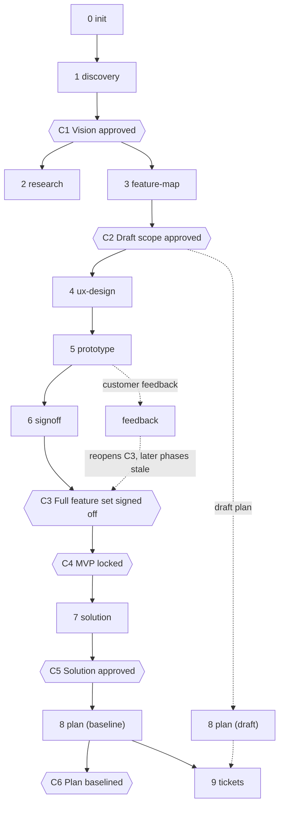

# kickoff

A Claude Code plugin that takes a software project from the first customer meeting to a baselined plan with tickets, through a fixed sequence of phases and approval gates. Twelve skills carry the judgement work: discovery, research, feature map, UX design, a full-product prototype, customer sign-off, solution design, plan and estimate, and tickets. A tested Python CLI does everything that must be exactly right: validation, the role-based schedule, the estimate workbook, generated documents, tracker sync and prototype checks. Approval gates are recorded in `.kickoff/state.yaml` with who approved, when, and the evidence. A customer-feedback loop can reopen the sign-off and marks every later output stale until it is re-run. All project data lives in plain YAML under `.kickoff/`, so every plan, estimate and ticket can be regenerated from it.

The core principle:

> Lock the MVP scope, but lock the **full** feature set with the customer first, using a clickable prototype of the final product. Only then design the database, technology, architecture and design patterns. Features built after that rarely expand in scope or need refactoring because of late customer feedback.

The plugin enforces this with gates: `solution` refuses to start until C3 (full feature set signed off) and C4 (MVP locked) are approved.

## Phases and gates



| # | Skill | May start when | Gate to leave |
| --- | --- | --- | --- |
| 0 | `kickoff:init` | no `.kickoff/` yet | none |
| 1 | `kickoff:discovery` | init done | C1 Vision approved |
| 2 | `kickoff:research` | discovery done, C1 | none (runs alongside 3) |
| 3 | `kickoff:feature-map` | discovery done, C1 | C2 Draft scope approved |
| 4 | `kickoff:ux-design` | feature-map done, C2 | none |
| 5 | `kickoff:prototype` | ux-design done, C2 | `kickoff proto check` passes |
| 6 | `kickoff:signoff` | prototype done | C3 Features signed off, C4 MVP locked |
| ↺ | `kickoff:feedback` | prototype done | reopens C3 |
| 7 | `kickoff:solution` | signoff done, C3 and C4 | C5 Solution approved |
| 8 | `kickoff:plan` | draft: feature-map done, C2; baseline: solution done, C5 | C6 Plan baselined |
| 9 | `kickoff:tickets` | plan done | none (repeats) |

Gate rules:

- A gate is approved only with `--by` (the approving role) and `--evidence` (a link to the record or commit). C4 needs C3; C6 needs C5.
- `kickoff:tickets` needs only `plan` done: a draft plan is enough, and C6 is not checked by the CLI. Push tickets from a draft plan only when the lead wants the preparation work tracked early; the baseline (C6) is what the team commits to.
- Reopening a gate (`kickoff gate reopen C3 --reason "..."`) marks every later phase that was done as stale. A stale phase blocks the phases that depend on it until it is re-run; re-running it removes the gates that follow it, so they are approved again.
- `kickoff:feedback` is not a phase; it is a loop that classifies customer feedback, applies it along the chain `features.yaml`, `ux-spec.md`, prototype, draft `plan.yaml`, schedule, and reopens C3.
- Every phase ends with real verification commands, then `kickoff phase done <phase>` and a Conventional Commit.

`kickoff:using-kickoff` is the router: it checks the tools, reads `kickoff status`, enforces the gates and hands over to the skill that comes next.

## Install

In Claude Code:

```
/plugin marketplace add ivai-dev/kickoff-plugin
/plugin install kickoff@kickoff
```

Then install the CLI from the installed plugin copy. The plugin lives under `~/.claude/plugins/cache/kickoff/kickoff/<version>/`:

```
uv tool install --force ~/.claude/plugins/cache/kickoff/kickoff/<version>/cli
```

Repeat the CLI install after every plugin update. `kickoff:using-kickoff` compares `kickoff --version` with the version in `.claude-plugin/plugin.json` and asks you to reinstall when they differ. The kit, the document templates and the LibreOffice Dockerfile ship inside the package, so the normal (non-editable) install works outside this checkout.

## Requirements

- Python 3.11 or newer and [uv](https://docs.astral.sh/uv/)
- [`gh`](https://cli.github.com/), signed in, for the GitHub tracker (`kickoff tickets ...`); the plugin stores no tokens
- Optional: Docker, for `kickoff workbook --verify` (LibreOffice recalculation)
- Optional: Microsoft Edge or Google Chrome, for `kickoff proto check` (set `KICKOFF_BROWSER` to any executable, or `proto.browser` in `project.yaml` to an Edge, Chrome or Chromium name such as `msedge` or `google-chrome`; other values in `project.yaml` are refused because a cloned repository could otherwise run any program)
- The `ui-ux-pro-max` skill, for the design phases; `kickoff:using-kickoff` stops with install instructions when it is missing
- Node 22 or newer, only for developing the prototype kit

## Quickstart

1. Open an empty repository in Claude Code.
2. Run `/kickoff`. With no `.kickoff/` folder it routes to `kickoff:init`, which interviews you and runs `kickoff init --name <name>`.
3. Follow the next step `/kickoff` names after each phase. It reads `kickoff status`, so it always knows which phase may start and which gate is waiting for approval.
4. `/kickoff-sync` pulls tracker state into the plan, recomputes the schedule and shows what `kickoff tickets push` would change.

## CLI reference

Run `kickoff --help` or `kickoff <command> --help` for every option. `--root DIR` selects the project (default: the nearest folder with `.kickoff/`).

| Command | What it does |
| --- | --- |
| `kickoff init --name NAME` | Create `.kickoff/` from a valid template and the docs folders; refuses if `.kickoff/` exists. |
| `kickoff status [--json]` | Show phases, gates, stale items and the suggested next step. |
| `kickoff can PHASE [--baseline]` | Exit 0 when the phase may start, 1 with the blocking phases and gates. |
| `kickoff phase start\|done PHASE` | Record phase progress; `done` clears the phase's stale marker. |
| `kickoff gate approve GATE --by ROLE --evidence LINK [--date D]` | Approve a gate; both `--by` and `--evidence` are required. |
| `kickoff gate reopen GATE --reason TEXT` | Reopen a gate and mark the later phases stale. |
| `kickoff validate` | Check schemas, IDs, dependencies and cycles; exit 1 on any error. |
| `kickoff schedule [--json FILE]` | Compute the role-based schedule and gate dates; warn when a hard date slips and list the scope-cut candidates. `--json` writes every package's dates to FILE. |
| `kickoff workbook [--out FILE] [--verify]` | Write the formula-only estimate workbook; `--verify` recalculates it with LibreOffice in Docker and compares it with the schedule. |
| `kickoff docs [--check]` | Generate `feature-map.md`, `wbs.md`, `risk-register.md` and the plan tables; `--check` fails if regeneration would change anything. |
| `kickoff tickets plan` | Print the issues the plan would create. |
| `kickoff tickets push [--dry] [--adopt]` | Create and update issues, sub-issues, blocked-by links and fields idempotently; `--dry` prints the diff. |
| `kickoff tickets pull` | Pull issue state and dates into `actuals` and show which gates moved. |
| `kickoff tickets link KEY NUMBER` | Map a WBS code or epic id to an existing issue before the first push. |
| `kickoff proto new [--force]` | Copy the prototype kit and write one stub per ux-spec screen; `config.js` gets `locale`, `lang` and `shell: "app"` from `languages.ui`, and the tokens get `--cap-case: none` for vi. |
| `kickoff proto update [--dry]` | Copy the kit core files over the project's copies and refresh `index.html` outside its title, tokens and modules blocks; never touches project modules; prints what changed (`--dry` only lists it). |
| `kickoff proto check [ROUTES...] [--shots DIR] [--jobs N]` | Open every screen and scenario in a headless browser (light and dark, plus a 390 px check); exit 4 when no browser is found. A route is `<screen>[-tokens][?key=value&…]` with role and other tokens and parameters, for example `"sc-08-guest?kiosk=1&id=tt03"` (quote it in the shell). `--shots` writes light, dark and 390 px screenshots. |
| `kickoff proto lint` | Count font sizes, weights, inline styles and raw colours against thresholds; flag forbidden text; fail when `languages.ui` is not English and `config.js` sets no `locale`. |
| `kickoff proto bundle [--out FILE]` | Write the prototype as one self-contained HTML file. |

## Prototype kit

`kickoff proto new` copies a no-build prototype kit (Preact and htm) into the project. Project files are `js/config.js`, `js/data.js`, the screen modules and `js/scenarios.js`; the kit core is never edited and is refreshed with `kickoff proto update`. The prototype shows exactly what the product will show: chrome, navigation and wording.

- **Shells.** `app`: a work tool with a sidebar (the default). `site`: a public site with a header, top menu, account area and footer, and on phones a compact header with a menu sheet and a bottom tab bar (`shell: "site"` and `tabs` on the role, `KIT_CONFIG.site` for the organisation line, account menu, sign-in links and footer). `android` screens show in a phone frame and `windows` screens in a Windows frame.
- **Bare screens.** `KIT.register(id, { bare })`, with `bare: true` or `(params, role) => boolean`, renders a screen without any shell: device frames such as a kiosk, full-screen start screens.
- **Route parameters.** `#<screen>[-light|-dark][-full|-tags|-mvp][-<platform>][-<role>][?key=value&…]`; integer values become numbers, `true`/`false` booleans. Deep links, the screen index and `kickoff proto check` keep them, so device views and records open from a link.
- **Localisation.** Every kit word, in the product area and in the prototype chrome, goes through `KIT.t(key, vars)` with `en` and `vi` packs, chosen by `KIT_CONFIG.lang` or the locale; `KIT_CONFIG.strings` overrides single strings. `KIT_CONFIG.locale` sets number formats.
- **Letter case.** The `--cap-case` token (`uppercase` by default, `none` for languages with stacked diacritics) drives `.t-cap` and table headers.

The full kit guide is `README.md` in the prototype folder after `kickoff proto new`.

## Examples

- `examples/ai-minute`: a full worked project (Vietnamese content, workbook language `vi`): features, a 205-package plan, ticket mappings and the golden schedule `expected/schedule.json` that the scheduler must reproduce. The generated documents under `examples/ai-minute/docs/` are kept in step with `kickoff docs --check`.
- `examples/mini`: a small Library Loans project with a working prototype (roles, scope modes, a scenario, a phone frame). CI runs `kickoff proto lint` and `kickoff proto check` on it.

Try them without changing anything:

```
cd cli
uv run kickoff --root ../examples/ai-minute status
uv run kickoff --root ../examples/ai-minute schedule
uv run kickoff --root ../examples/mini proto lint
```

## Development

```
cd cli
uv run ruff check .
uv run pytest -q
```

From the repository root, the prototype kit tests:

```
node --test "cli/src/kickoff/kit/prototype/test/*.test.js"
```

Tests run offline except those marked `browser` (need Edge or Chrome and the CDN) and `docker` (need Docker); both skip when the tool is missing. CI (`.github/workflows/ci.yml`) runs lint and tests on Python 3.11 and 3.13, the kit tests, the examples checks, the test suite on Windows and a wheel check.

The design is in `docs/specs/2026-09-26-kickoff-plugin-design.md`, the implementation plan in `docs/plans/2026-09-26-kickoff-plugin.md`, the v0.2.0 plan in `docs/plans/2026-10-20-kickoff-v0.2.0.md`. Changes per release are in `CHANGELOG.md`.
