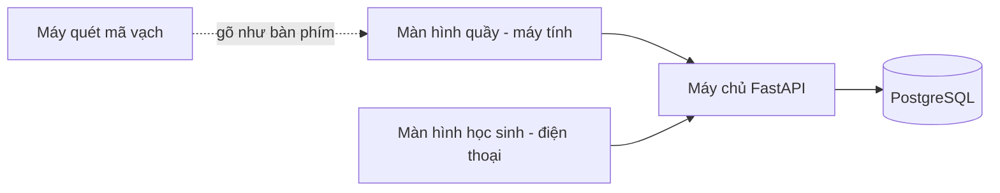

# Thiết kế

## Giải pháp

Một web app dùng chung cho thủ thư (máy tính ở quầy) và học sinh (điện thoại), một máy chủ, một cơ sở dữ liệu.

## Kiến trúc

## Công nghệ

- Giao diện: React + Vite, một lớp gọi API duy nhất (`src/api/`); dữ liệu mẫu qua MSW khi chưa có máy chủ.
- Máy chủ: Python FastAPI; cơ sở dữ liệu PostgreSQL.
- Chạy trên một máy chủ ảo của trường.

## Bản đồ màn hình

| Thủ thư cho mượn | Thủ thư nhận trả | Học sinh xem sách | Thủ thư xem quá hạn |
| --- | --- | --- | --- |
| Quầy: quét thẻ | Quầy: quét sách | Đăng nhập | Danh sách quá hạn |
| Quầy: quét sách | Xác nhận trả | Sách đang mượn | |
| Xác nhận mượn | | Hạn trả | |
| — bản đầu ở trên đường này — | | | Báo cáo tháng (bản sau) |

## Hướng giao diện

Đã chọn **"Quầy nhanh"**: dày thông tin, thao tác bằng bàn phím và máy quét trước, chuột sau. Phương án không
chọn: "Thẻ thân thiện" (thoáng, nhiều hình ảnh, chậm hơn ở quầy).

## Quy tắc thiết kế

- Mọi thao tác ở quầy làm được không cần chuột (lý do: thủ thư cầm sách và máy quét).
- Ngày luôn dạng 28/10/2026; hạn trả đỏ khi đã quá (lý do: thói quen đọc sổ tay).
- Chữ tối thiểu 16px trên điện thoại (lý do: học sinh lớp 6).

## Quyết định

### Một web app cho cả hai nhóm người dùng (2026-09-08)

Chọn web app thay vì app điện thoại riêng cho học sinh vì học sinh chỉ cần xem, không cần cài đặt. Bỏ qua: thông
báo đẩy trên điện thoại. Đổi về sau sẽ tốn: làm thêm một app riêng.

### Máy quét dùng như bàn phím (2026-09-12)

Thử nghiệm cho thấy máy quét cũ gõ mã như bàn phím, không cần trình điều khiển. Bỏ qua: đọc trực tiếp từ cổng USB.
